<div align="center">



<br/>


<br/><br/>


</div>

<br/>

## [+] whoami

```bash
┌──(aarish㉿kali)-[~]
└─$ cat whoami.txt

  NAME      : Muhammad Aarish
  ROLE      : Cybersecurity Enthusiast  //  MERN Stack Developer
  FOCUS     : SIEM (Wazuh) · Cloud Security · AI-driven Threat Detection
  BUILDS    : Secure infrastructure + automated threat-monitoring systems
  MINDSET   : Think like an attacker, build like a defender
  STATUS    : Online. Learning. Breaking things in my lab (legally).

┌──(aarish㉿kali)-[~]
└─$ _
```

<br/>

## [+] mission.log

| | |
|---|---|
| 🛡️ **Blue team** | Monitoring, detection and response with SIEM (Wazuh) and cloud-network telemetry |
| 🕵️ **Red team curiosity** | Recon, scanning and exploitation practice inside isolated lab VMs |
| ⚙️ **Full-stack** | Production-style MERN apps with real-time dashboards and APIs |
| 🤖 **AI + Security** | Machine-learning models that spot attacks in network traffic |

<br/>

## [+] arsenal

**Security toolkit**

<p>
  
  
  
  
  
  
  
  
</p>

**Development stack**

<p>
  
</p>

<br/>

## [+] featured-project

<table>
<tr>
<td>

### 🦅 CloudHawk - AI-Enabled Cloud Security Monitoring
*Final Year Project*

Detects attacks in cloud-network traffic with machine learning and shows them on a live SOC-style dashboard.

- 🧠 **Model:** Random Forest trained on CICIDS2017, classifies Normal, DoS, DDoS, Port Scanning, Brute Force, Web Attacks and Bots
- ⚡ **Model API:** Python + FastAPI `/predict` with per-alert explanation
- 🖥️ **Dashboard:** MERN stack, live alerts over Server-Sent Events, network map, dark/light SOC theme
- 🎯 **Response:** automated containment playbooks and MITRE ATT&CK tagging

`Python` · `scikit-learn` · `FastAPI` · `MongoDB` · `Express` · `React` · `Node.js`

</td>
</tr>
</table>

<br/>

## [+] 🐍 Contribution Snake Game
> *An automated GitHub Action renders this snake eating up my contribution graph daily!*

<div align="center">
  <picture>
    <source media="(prefers-color-scheme: dark)" srcset="https://raw.githubusercontent.com/aarish-irfan/aarish-irfan/main/dist/github-contribution-grid-snake-dark.svg">
    <source media="(prefers-color-scheme: light)" srcset="https://raw.githubusercontent.com/aarish-irfan/aarish-irfan/main/dist/github-contribution-grid-snake.svg">
    
  </picture>
</div>

<br/>

## [+] stats.sh

<div align="center">
  
</div>

<div align="center">
  
</div>

<br/>

<details>
<summary><b>[+] lab.notes - what I am practising right now</b></summary>

<br/>

- 🔎 Writing detection rules and decoders in **Wazuh**
- ☁️ Cloud security: monitoring, logging and least-privilege basics
- 🧪 Hands-on rooms and wargames on **TryHackMe** and **OverTheWire**
- 🦠 Static analysis of samples in an isolated VM with **Ghidra**
- 📡 Packet analysis with **Wireshark**
- 🚀 Shipping full-stack projects with the **MERN stack**

</details>

<br/>

## [+] contact

<p>
  <a href="https://www.linkedin.com/in/YOUR-LINKEDIN-USERNAME"></a>
  <a href="mailto:YOUR-EMAIL@example.com"></a>
  <a href="https://YOUR-PORTFOLIO-URL"></a>
</p>

> ⚠️ **Disclaimer:** everything I test is done in my own lab or with explicit permission. Ethical hacking only.

<div align="center">
  
</div>
